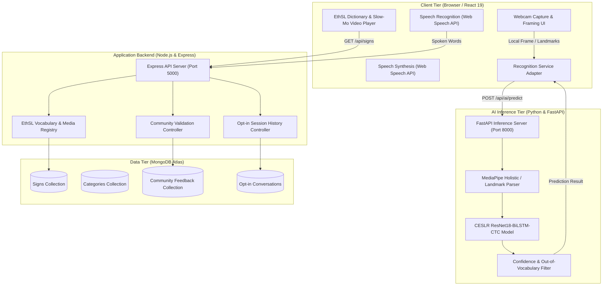
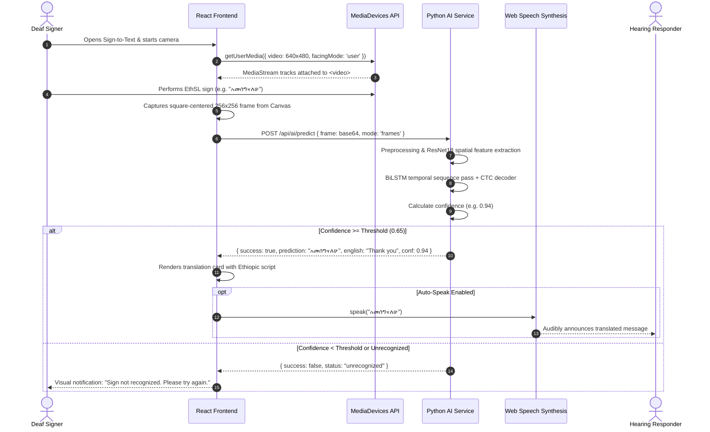
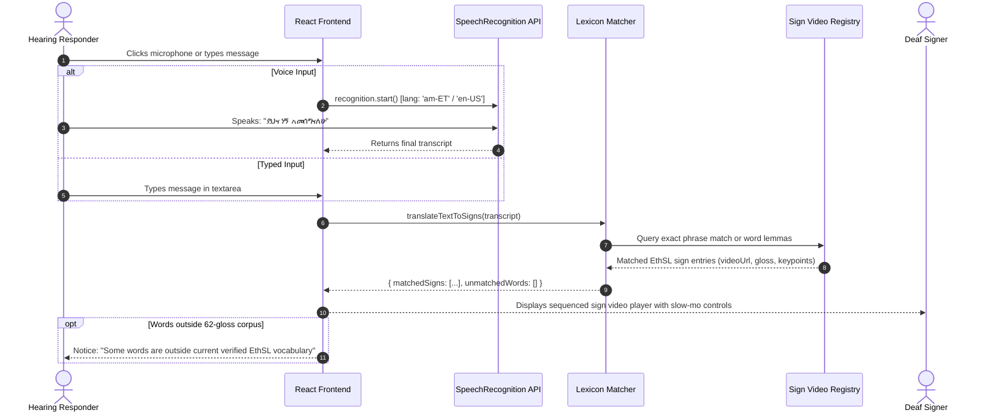

# 2. System Architecture & Component Flows

## 2.1 Multi-Tier Architecture Overview

EthioSign is engineered with a modular, service-oriented architecture ensuring separation of concerns between client rendering, application data services, and heavy computer vision inference:

---

## 2.2 Sequence Diagram: Direction A (Sign-to-Text & Speech)

The following sequence diagram details the real-time processing flow from a Deaf user signing in front of the camera to the spoken audio output:

---

## 2.3 Sequence Diagram: Direction B (Speech/Text-to-Sign)

The following sequence diagram details how hearing users communicate back using speech or text:

---

## 2.4 Privacy & Biometric Data Security Model

Because EthioSign processes potentially sensitive visual and audio data, security and user privacy are foundational:

| Privacy Principle | Implementation Details |
| :--- | :--- |
| **Volatile In-Memory Processing** | Camera frames captured to canvas are held strictly in browser RAM or processed in transient server worker memory during inference. Frames are automatically garbage-collected and never written to disk. |
| **No Involuntary Recording** | Raw webcam video streams and microphone audio clips are **never** stored on databases, cloud buckets, or third-party analytical endpoints. |
| **Explicit Hardware Release** | Stopping the camera or microphone calls `MediaStreamTrack.stop()` across all active tracks, completely shutting down hardware sensors and physical indicator LEDs. |
| **Local-Only Opt-in History** | Conversation session logging is disabled by default. If a user explicitly turns on "Save History", data is preserved solely inside the client's private `localStorage` with a single-click "Clear All Data" wipe button. |
| **Human Validation vs AI Prediction** | The user interface maintains a strict visual boundary between validated community demonstrations and automated AI predictions with confidence ratings. |
